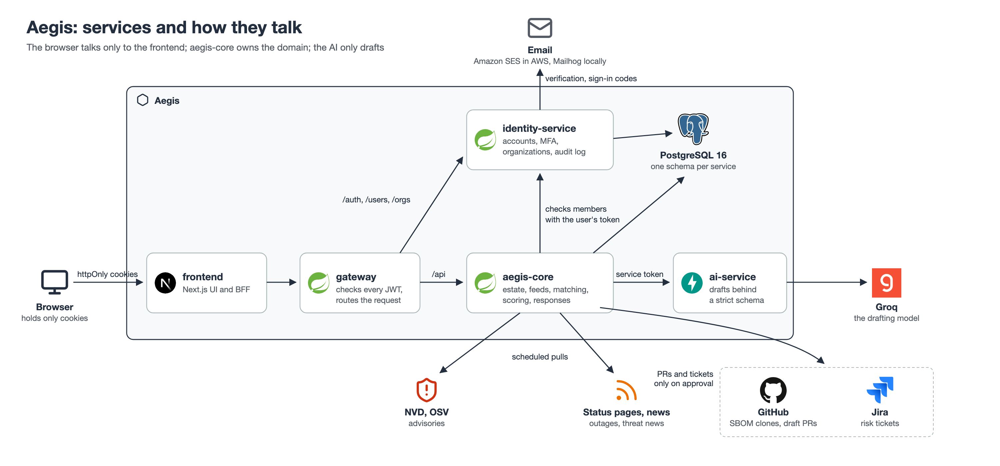
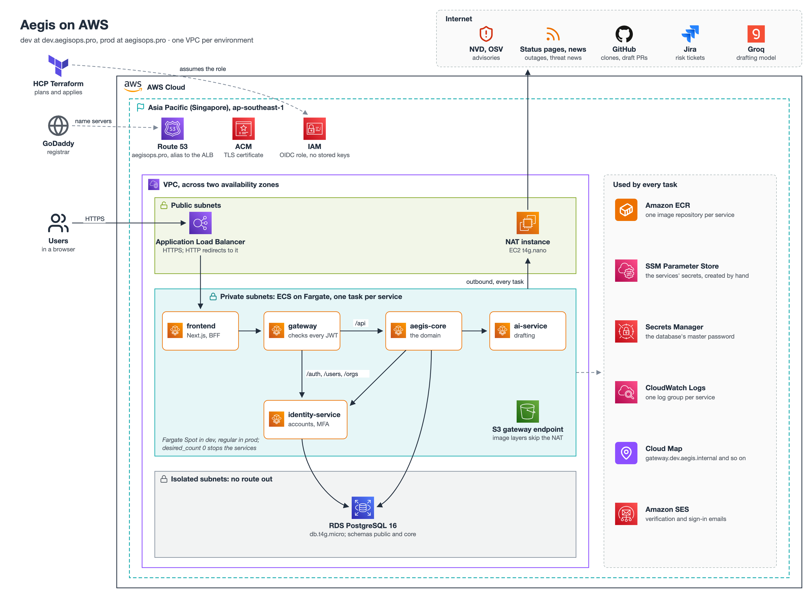

# Aegis

Aegis is a **supply-chain and operational-resilience platform** for organizations that run many services. It maps
each service's dependencies, watches vulnerability advisories, vendor outages and security news, works out which
services each change reaches and how much it matters, and drafts the response (a safe-upgrade pull request, a risk
ticket, a regulator notification) for a person to approve. Nothing reaches your code, your tracker or a regulator
without that approval.

## How it works

1. **Map the estate.** Register services with their owners, business criticality and internet exposure. Link a
   service's repository and Aegis generates its SBOM, which becomes that service's dependency graph.
2. **Watch for change.** Scheduled connectors pull advisories from NVD and OSV, vendor status pages and security
   news, and keep one record per CVE.
3. **Match.** Each change is checked against every service's dependency graph, direct and transitive, with
   ecosystem-aware version comparison and the evidence for each match.
4. **Score.** Impact per service and per owner: severity × exposure × business criticality, tiered from critical to
   low, with every factor shown.
5. **Draft.** For a vulnerability, a risk ticket plus a pull request that moves each affected dependency to the
   lowest version clearing every advisory. When a service is materially affected, a DORA notification memo. The
   AI writes only the narrative, citing its sources.
6. **Decide.** A person approves or dismisses, with a reason. Whoever drafted a pull request can't approve it.
7. **Act.** Approval files the ticket in Jira, then opens the pull request as a draft on GitHub. A memo is only made
   final, for a person to submit; Aegis never sends it.

Matching and scoring are deterministic code, and every decision is a person's. The model only drafts; it never
decides or acts.

## What's built

| Area | State |
|---|---|
| Accounts and organizations | Open sign-up or invite-only; email verification and password reset; a second factor at sign-in by email code, authenticator app (TOTP) or passkey (WebAuthn); sign-in rate limits and lockout; organizations with members and roles; an append-only log of sign-in and admin events |
| Estate | Services, components, vendors and owners; SBOMs generated from a linked repository or uploaded as CycloneDX; each service's own dependency graph; **Used by** for any package or vendor |
| Change feeds | NVD; OSV for npm, PyPI, Maven, Go, crates.io and RubyGems; vendor status pages; security news |
| Matching and scoring | Recomputed on every request; impact per service and per owner, with the factor holding each score down |
| Dashboard | Open material items by service and owner, critical/high counts, unassigned items and response stages; links to filtered triage. A 7-, 30- or 90-day trend of daily observed totals, with gaps where no observation exists |
| Findings | The **triage queue**: each service's material vulnerable dependencies, with the version that fixes them, and the vendor outages still in progress, highest impact first; filters by service, owner, ecosystem and impact; each item's response, or **Draft response**; **My services**, a service owner's own page: each service they own with what needs a response, the responses awaiting a decision and whether its SBOM and repository are in place, then its items; item detail with the affected services and owners, score factors, evidence and drafted responses. **Notifications**: each owner is told once, under the bell and by email, about every item in their services that needs a decision |
| Responses | Drafted responses awaiting a decision, and their history; risk tickets filed in Jira; draft upgrade pull requests on GitHub for Maven `pom.xml`, npm `package.json` and PyPI `requirements.txt`; DORA regulator memos; four-eyes approval. Before deciding, a reviewer may edit the drafted text or override the priority and due date with a reason (and withdraw the override), both kept on record; each response and triage item shows its stage (New → In review → Approved or Overridden → Actioned or Closed). Every step a response takes is recorded in an append-only decision trail, with who took it, why, and the response as it stood then; analysts and compliance admins search it under **Reports → Audit log** by service, person, decision and date, and export a service's evidence for a period as PDF or CSV from **Reports → Evidence**. Each service's page lists its own vulnerable dependencies too, including those another package pulls in |
| AI | Drafting through Groq, or an offline stub by default, with citations the server resolves and rate and token budgets |
| Not yet | Stored findings with a lifecycle status (the triage queue is recomputed on every request); reachability in the score (the assessment endpoint exists, but nothing calls it yet) |

## Architecture



| Service | Stack | Port | What it does |
|---|---|---|---|
| [frontend](frontend/README.md) | Next.js 16, Base UI | 3000 | The UI, and a backend-for-frontend: tokens live in httpOnly cookies, and the browser never calls the API itself |
| [gateway](backend/gateway/README.md) | Spring Cloud Gateway | 8080 | The single entry point: validates every JWT, routes `/auth`, `/users` and `/orgs` to identity-service and `/api` to aegis-core |
| [identity-service](backend/identity-service/README.md) | Java 21, Spring Boot 4 | 8081 | Accounts, MFA, organizations and roles; signs RS256 JWTs (JWKS at `/oauth2/jwks`); the audit log |
| [aegis-core](backend/aegis-core/README.md) | Java 21, Spring Boot 4 | 8082 | The domain: estate, SBOM import, feeds, matching, scoring, responses, and the GitHub and Jira connections |
| [ai-service](backend/ai-service/README.md) | Python 3.12, FastAPI | 8083 | Drafting behind a strict schema; reachable only from aegis-core, with a service token |

One PostgreSQL 16 database holds a schema per service (`public` for identity-service, `core` for aegis-core), each
migrated by Flyway.

**Security model.**
- The gateway authenticates every request; identity-service and aegis-core validate the token again and authorize
  it. ai-service accepts only aegis-core's service token.
- Each organization is a tenant. Every estate and response row carries its organization, enforced by the code and
  by PostgreSQL row-level security.
- No one grades their own homework:
  - Analysts and compliance admins register services, grade them and assign their owners.
  - Owners maintain only their own services.
  - Whoever drafts a pull request never approves it.
  - Compliance admins audit responses, read-only.
- An organization's admin connects its GitHub installations and Jira site, after a sign-in proves they control them.
  Jira tokens are sealed with AES-GCM.
- Feed and model text is untrusted. It's made inert in pull request bodies and Jira descriptions.

## Run it locally

With Docker running:

```bash
docker compose up --build
```

| Service | Address | Notes |
|---|---|---|
| Frontend | http://localhost:3000 | Start here |
| Gateway | http://localhost:8080 | The API's entry point |
| identity-service | http://localhost:8081 | API docs at `/swagger-ui.html` |
| aegis-core | http://localhost:8082 | API docs at `/swagger-ui.html` |
| PostgreSQL | localhost:5432 | User and password `identity` |
| Mailhog | http://localhost:8025 | Catches every email, whatever the address |
| Prometheus, Zipkin | http://localhost:9090, http://localhost:9411 | Metrics and traces |

ai-service has no address on your machine: only aegis-core can reach it.

**First sign-in.**
1. Sign up at http://localhost:3000. The verification link and each sign-in code arrive in Mailhog.
2. Create an organization. You're its admin: you manage its members and integrations.
3. The estate pages need a domain role, which an organization's admin can't give themselves. Invite a second
   address under **Admin → Users**, set its password from the invitation in Mailhog, and give it **Analyst** (or
   **Service owner**).
4. Sign in as that member, add a service under **Inventory → Services** and link its repository.

Compose also seeds a platform admin, `admin@example.com` / `admin-dev-password`. It belongs to no organization and
manages accounts across all of them.

**Optional integrations.** Copy [`.env.example`](.env.example) to `.env` (git-ignored) and fill in what you want:

| To | Set |
|---|---|
| Draft with a real model | `LLM_PROVIDER=groq` and `GROQ_API_KEY` |
| Raise NVD's rate limit from 5 to 50 requests per 30 seconds | `AEGIS_NVD_API_KEY` |
| Open upgrade pull requests and clone private repositories | `AEGIS_GITHUB_ENABLED=true`, the GitHub App's client ID and secret, and its key: see [GITHUB_APP.md](backend/aegis-core/GITHUB_APP.md) |
| File risk tickets in Jira | `AEGIS_JIRA_ENABLED=true`, the Atlassian app's client ID and secret, and `AEGIS_SECRETS_KEY`: see [JIRA.md](backend/aegis-core/JIRA.md) |

## Configuration

Every setting is an environment variable with its default in the service's `application.yml`. The ones you're most
likely to change:

| Variable | Service | Default | What it does |
|---|---|---|---|
| `REGISTRATION_ENABLED` | identity-service | `true` | Public sign-up. `false` makes it invite-only, and the UI hides sign-up |
| `ORG_SIGNUP_ENABLED` | identity-service | `true` | Whether a signed-in user may create an organization |
| `MFA_EMAIL_OTP_ENABLED`, `MFA_TOTP_ENABLED`, `MFA_WEBAUTHN_ENABLED` | identity-service | `true`, `false`, `false` | Which second factors are offered (compose turns all three on) |
| `IDENTITY_JWT_PRIVATE_KEY` | identity-service | generated at startup | The PKCS#8 PEM that signs tokens. Without it, sessions end at every restart and two instances reject each other's tokens |
| `AEGIS_INGESTION_NVD_ENABLED`, `…_OSV_…`, `…_VENDOR_STATUS_…`, `…_NEWS_…` | aegis-core | `false` | Which feeds are pulled (compose turns all four on) |
| `AEGIS_DEMO_SEED_ENABLED` | aegis-core | `false` | Seeds a sample estate into the fixed organization the tests use, not into one you create |
| `LLM_PROVIDER` | ai-service | `stub` | `stub` or `groq` |
| `TRUSTED_PROXY_HOPS`, `GATEWAY_TRUSTED_PROXIES` | frontend, gateway | 1, any private address | Which `X-Forwarded-For` address the sign-in rate limit trusts: the proxies in front of the frontend, and the addresses the gateway accepts the header from |

Scoring weights and tiers: [SCORING-CALIBRATION.md](backend/aegis-core/SCORING-CALIBRATION.md). Metrics and ready-made
PromQL: [ops/README.md](ops/README.md).

## Deploy to AWS

Aegis runs on AWS in Singapore (`ap-southeast-1`) at **aegisops.pro**, built by the Terraform in
[`terraform/`](terraform/README.md) through HCP Terraform. Dev serves https://dev.aegisops.pro while it's running,
and is stopped between demos. Prod is written but not applied yet.



- **Only the load balancer is public**, and it forwards to the frontend alone. Each service is its own Fargate task
  with its own security group, so it accepts only the callers drawn above; the database accepts only
  identity-service and aegis-core.
- **Services find each other by name** through Cloud Map, e.g. `gateway.dev.aegis.internal:8080`.
- **Outbound traffic** (the feeds, GitHub, Jira, Groq, SES) leaves through one small NAT instance instead of a NAT
  Gateway. Image layers come from S3 through a gateway endpoint.
- **No secret is in Terraform's state.** The services' secrets are SSM parameters a person creates. The database's
  master password is RDS's own, kept in Secrets Manager. Everything is encrypted with AWS-managed keys.
- **Dev runs on Fargate Spot, prod on regular Fargate.** Setting `desired_count = 0` stops the services between
  demos.
- **Images are built for `linux/amd64` and pushed to ECR by hand** for now. A push role for GitHub Actions is ready
  for when a workflow does it.

Where to go next:
- [terraform/README.md](terraform/README.md): the layout and how to run it.
- [terraform/environments/README.md](terraform/environments/README.md): a first deploy, step by step.

## Testing

| Service | Command | Needs |
|---|---|---|
| identity-service | `./mvnw verify` | Docker (Testcontainers) |
| aegis-core | `./mvnw verify` | Docker. `./mvnw -Dtest=PackageStructureArchTest test` checks the module boundaries without it |
| gateway | `mvn verify` | Nothing else |
| ai-service | `pip install -e '.[dev]'`, then `pytest` | Nothing else |
| frontend | `pnpm exec tsc --noEmit`, `pnpm lint`, `pnpm build` | Nothing else |
| frontend end to end | `pnpm exec playwright install chromium`, then `pnpm test:e2e` | The stack running (`docker compose up`) |

Run each from the service's folder. Every service has its own workflow in [`.github/workflows`](.github/workflows),
run on the pushes and pull requests that touch it: `identity-service-ci`, `gateway-ci`, `aegis-core-ci`,
`ai-service-ci` (ruff and pytest) and `frontend-e2e` (Playwright).

### Security scanning

`security-scanning` runs on every pull request and every push to `develop` and `main`. A committed secret or a
known-vulnerable dependency fails it:

- **Secrets** — gitleaks (the CLI, pinned and checksummed) scans the commits the change adds. The only exceptions are
  the test fixtures and documentation that merely look like secrets, listed in [`.gitleaks.toml`](.gitleaks.toml)
  with why; each allows that exact text, never a whole file. Never allow-list a real secret: revoke and rotate it.
  To run it locally: `gitleaks git --config .gitleaks.toml .`
- **Dependencies** — GitHub's dependency review fails a pull request that adds a dependency with any known
  vulnerability (runtime, development or unknown scope). Maven resolves each Java service's whole graph first and
  submits it, so versions the Spring Boot parent manages are reviewed too; the frontend is reviewed from
  `pnpm-lock.yaml`. GitHub doesn't read the ai-service's `pyproject.toml` (PEP 621), so its dependencies aren't
  reviewed yet.
- **Code** — CodeQL analyses the Java, TypeScript/JavaScript and Python code (no build needed), and weekly on the
  default branch. Its alerts are under the repository's **Security → Code scanning**, and its check fails a pull
  request that adds an alert at or above the threshold set in the repository's settings.

There's no Dependabot: Aegis watches its own dependencies, so a second bot opening upgrade pull requests would
compete with it.

### Threat model and data classification

[`security/threat-model.md`](security/threat-model.md) goes through each trust boundary with STRIDE and the OWASP
risks for LLM applications: every threat has an owner and either the code that mitigates it or a recorded decision
to accept it. [`security/data-classification.md`](security/data-classification.md) lists every kind of data Aegis
holds — its class, where it's kept, who reads it, how long it's kept and what leaves Aegis — checked against the
privacy notice. Update both when a trust boundary, a role, an integration or a data store changes.

[`security/access-control.md`](security/access-control.md) lists every endpoint of the gateway, identity-service and
aegis-core with the roles that may call it. `GatewayAccessTest`, `IdentityAccessIntegrationTest` and
`AccessControlIntegrationTest` call each one anonymously and as each role, check the answer against the table, and
fail on an endpoint the table doesn't list — so a new endpoint, or a change to who may call one, updates the table in
the same pull request.

## Repository layout

```
backend/
  identity-service/   accounts, MFA, organizations, roles, audit log
  gateway/            the entry point: JWT validation and routing
  aegis-core/         the domain: estate, feeds, matching, scoring, responses
  ai-service/         drafting, in Python
frontend/             Next.js UI and backend-for-frontend
terraform/            AWS: bootstrap, global, environments/dev and prod, modules
ops/                  Prometheus configuration and PromQL
assets/diagrams/      the README's diagrams: SVG sources and their PNGs
docker-compose.yml    the whole stack, locally
```
